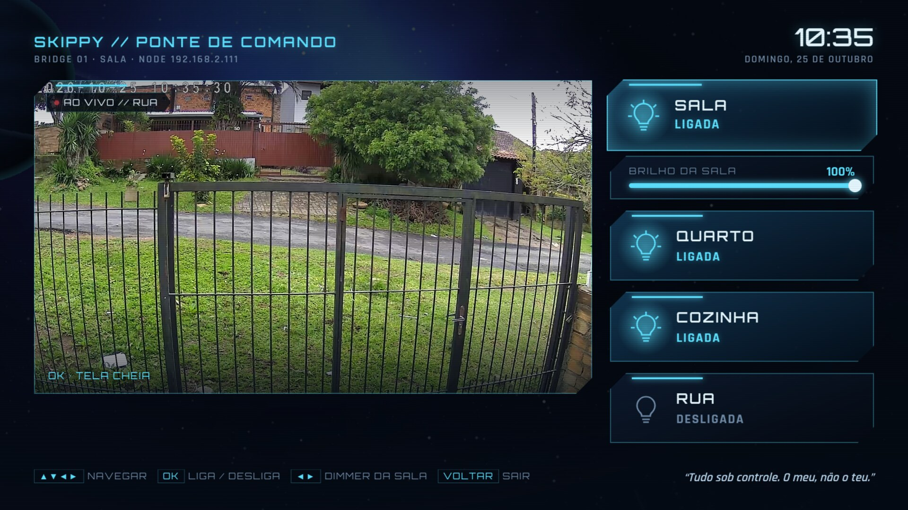
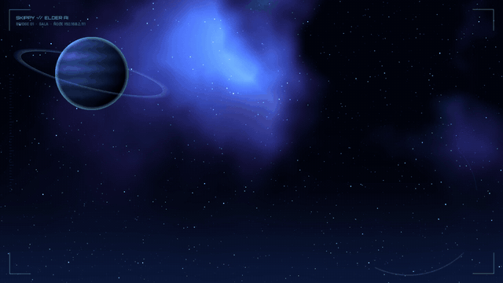

# Skippy TV

A sci-fi "starship bridge" home screen for Android TV boxes, wired to a real house:
an animated wallpaper, neon app banners, live cards (Plex *continue watching*, room
climate from Home Assistant, a street-camera snapshot, light status) and a **Bridge
panel** with the street camera **live** (~1 s latency, hardware decoded) and the house
lights (on/off + dimmer).

Runs on two very different devices:

| Device | OS | How it is themed |
|---|---|---|
| NVIDIA Shield (living room) | Android TV 11 | [Projectivy Launcher](https://play.google.com/store/apps/details?id=com.spocky.projengmenu) + a custom icon pack + cards published as Android TV *Watch Next* |
| Fire TV Stick 4K, 1st gen (bedroom) | Fire OS 6 (Android 7.1) | A **custom launcher** (`Home` activity), because Projectivy needs Android 10 |


| Bridge panel (camera + lights) | Camera full screen |
|---|---|
|  |  |

| Fire TV launcher | Fire TV — all apps |
|---|---|
|  |  |

Animated wallpaper (24 s seamless loop, rendered procedurally — no AI, no stock footage):



## Want one for your house? Ask an AI agent

This is a reference build for one specific house, not an installer. Give an AI coding agent with shell and
`adb` access on your LAN (Claude Code, Codex, Cursor…) this repo and a prompt like:

> Read https://github.com/cascodigital/skippy-tv, starting with `AGENTS.md`. Build the same kind of
> home screen for my TV box (model: ___). My Home Assistant is at ___; I want these lights: ___ (this one
> dims: ___). Camera via go2rtc at ___ (or none). Plex at ___ (or none). Docker host: ___. Ask me for
> anything missing, never commit tokens, and show me a screenshot after every visual step.

`AGENTS.md` tells the agent which path fits the device (Projectivy on Android TV 10+, custom launcher on
Fire OS / older Android), what to change, in which order, and the traps we already measured.

## Pieces

```
.
├── gen.py              static wallpaper + 640x360 neon banners (Simple Icons → cyan glow HUD frame)
├── anim.py             animated wallpaper: raw RGB frames → ffmpeg (parallax stars, drifting nebula, radar, shooting star)
├── build-iconpack.sh   "Skippy Icon Pack" APK (ADW icon-pack format, no code) for Projectivy
├── cards/              skippy-cards: Python server (Docker) that renders the HUD cards and serves the Bridge panel
│   ├── app.py          /feed.json, /c/*.png, /ponte, /api/lights, POST /api/light (allow-list)
│   └── ponte.html      Bridge panel UI (D-pad driven)
├── channel-app/        Android app dev.skippy.channel (plain Java, no Gradle)
│   ├── src/…/Sync.java     pulls the feed → Watch Next + preview channel (Android 8+)
│   ├── src/…/Main.java     card click trampoline (Projectivy rewrites the card intent package)
│   ├── src/…/Ponte.java    Bridge panel: transparent WebView over a SurfaceView
│   ├── src/…/LiveCam.java  MPEG-TS demuxer → MediaCodec (low-latency live camera)
│   ├── src/…/Home.java     custom launcher (Fire TV): looping video wallpaper + assets/home.html
│   └── src/…/Watch.java    Fire TV: brings Home back when the Amazon home shows up
├── fonts/              Orbitron, Rajdhani (SIL OFL)
└── logos/              Simple Icons SVGs + a few drawn ones
```

Architecture, data flow and every device quirk we hit (all measured): [docs/ARCHITECTURE.md](docs/ARCHITECTURE.md).

## Build

Toolchain without root or Android Studio: JDK 21, build-tools 34, `android-34.jar`
in `~/ai/tools/android-build/` (see the doc). Python 3.12 with `pillow numpy scipy cairosvg` in `./venv`.

```bash
python3 -m venv venv && venv/bin/pip install pillow numpy scipy cairosvg
venv/bin/python -I gen.py $PWD                       # dist/out/wallpaper.jpg + banners
venv/bin/python -I anim.py $PWD | ffmpeg -f rawvideo -pix_fmt rgb24 -s 1920x1080 -r 30 -i - \
  -c:v libx264 -preset slow -crf 19 -pix_fmt yuv420p dist/out/wallpaper-anim.mp4
HUD_NODE='BRIDGE 02  ·  QUARTO  ·  NODE 192.168.2.140' venv/bin/python -I anim.py $PWD | ffmpeg … dist/out/wallpaper-anim-quarto.mp4
./build-iconpack.sh                                  # dist/skippy-iconpack.apk
channel-app/build.sh                                 # dist/skippy-channel.apk
```

Signing key and password live **outside** the repo: `~/ai/keys/skippy.keystore` and
`~/ai/keys/skippy-keystore.pass` (override with `KEYSTORE` / `KEYSTORE_PASS_FILE`).
Everything generated goes to `dist/` (git-ignored).

## Deploy

```bash
# cards server (on the Docker host 192.168.2.46)
scp cards/{app.py,ponte.html,Dockerfile,docker-compose.yml,wallpaper.jpg} h46:/dados/dockers/skippy-cards/
scp -r fonts h46:/dados/dockers/skippy-cards/
ssh h46 'cd /dados/dockers/skippy-cards && docker compose up -d --build'
# .env on the host only: PLEX_TOKEN, PLEX_MID, HASS_TOKEN, HASS_URL, PLEX_URL, PUBLIC_URL (see cards/.env.example)

# devices
adb -s 192.168.2.111:5555 install -r dist/skippy-channel.apk dist/skippy-iconpack.apk   # Shield
adb -s 192.168.2.140:5555 install -r dist/skippy-channel.apk                            # Fire TV
adb -s <device> shell dumpsys deviceidle whitelist +dev.skippy.channel                  # both: Doze would cut its network
adb -s 192.168.2.140:5555 shell appops set dev.skippy.channel GET_USAGE_STATS allow      # Fire TV only (Watch)
```

## Security notes

Built for a private home LAN. The cards server keeps the Home Assistant and Plex tokens
server-side and only exposes an **allow-list** of four light groups
(`POST /api/light`, anything else → 403) — but it has **no authentication**: anyone on the
LAN can toggle those four lights. Do not expose port 8099 to the internet.

## Credits

Fonts: Orbitron and Rajdhani (SIL Open Font License). Logos: [Simple Icons](https://simpleicons.org) (CC0);
brands belong to their owners. Launcher on the Shield: Projectivy Launcher by spocky.

## License

MIT — see [LICENSE](LICENSE).
