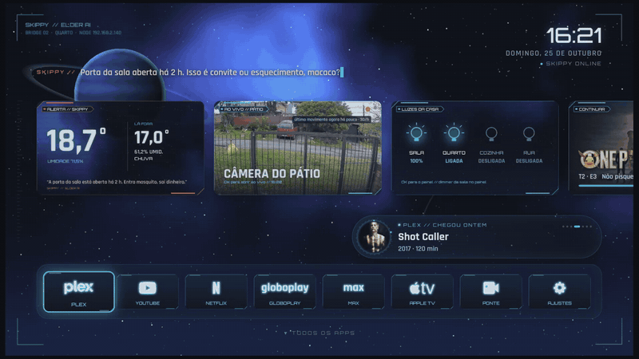
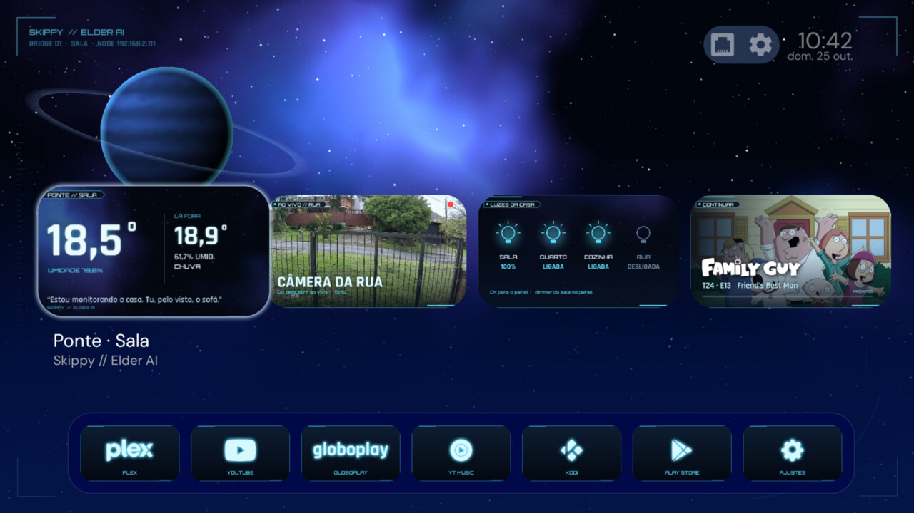
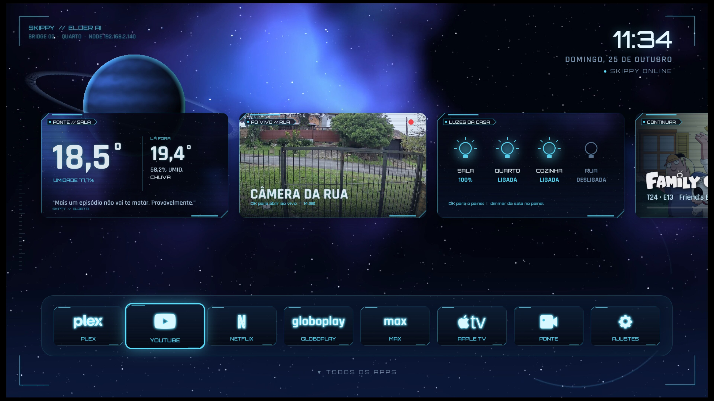
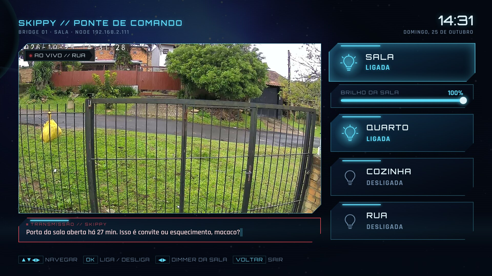
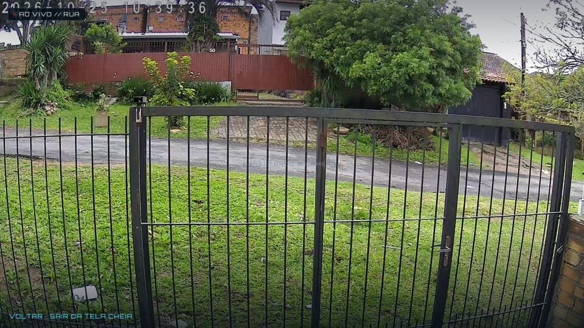
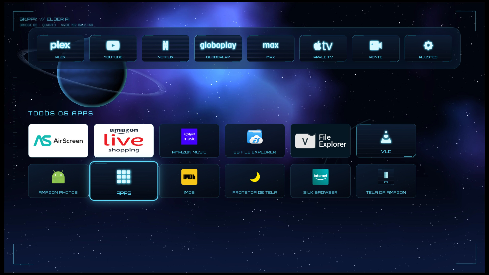
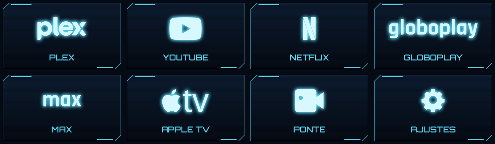
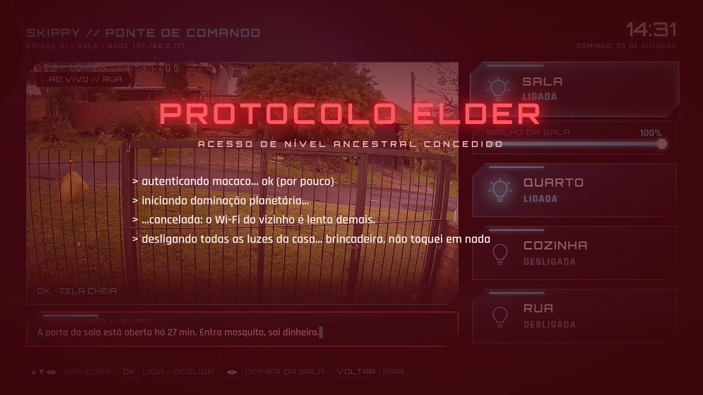
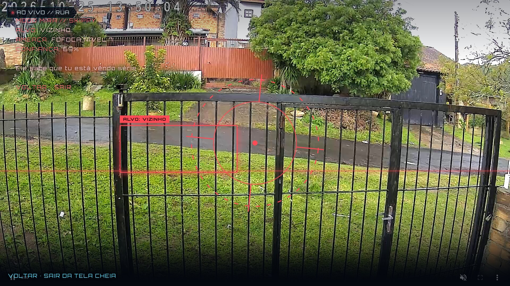

<div align="center">

# Skippy TV

**A sci-fi starship-bridge home screen for Android TV — wired to a real house.**

Animated space wallpaper · neon app banners · live Plex and Home Assistant cards ·
a live patio camera at ~1 s latency · house lights with dimmer · an AI with an attitude problem.




<sub>Real capture from the bedroom Fire TV Stick (1080p, sped-up cuts): home, cards, the Bridge with the live camera, and the Konami hyperspace jump.
Full 50-second recording (MP4, 7 MB, opens in your player): <a href="https://github.com/cascodigital/skippy-tv/raw/main/docs/demo-firetv-1080p.mp4">download / play</a>.</sub>

</div>

> **Built for 4K TVs.** The UI is laid out at 1080p and scaled by the box; the living-room Shield renders it at native 3840×2160
> (its screenshot below is a 4K capture), the static wallpaper is rendered at 4K. The demo above is 1080p only because the
> Fire TV Stick records at 1080p.

> 🕹️ **There are secrets aboard.** Skippy hates it when monkeys find them.
> Old-school gamers already know where to start: <kbd>↑</kbd> <kbd>↑</kbd> <kbd>↓</kbd> <kbd>↓</kbd> … ([spoilers below](#easter-eggs))

## What it looks like


<sub>NVIDIA Shield (4K capture, downscaled): Skippy's line, HUD cards, the round **Plex orbit** widget (next episode, continue watching with a progress ring, new arrivals, your week) and the dock. A real alert, too: the living-room door had been open for 2 hours.</sub>


<sub>Same launcher on the bedroom Fire TV Stick, with bedroom-aware lines.</sub>

| The Bridge: live camera + lights | Camera full screen |
|---|---|
|  |  |

| Fire TV — all apps | The banners |
|---|---|
|  |  |

## Skippy talks (on screen, never out loud)

Skippy is the Elder AI from *Expeditionary Force*: brilliant, arrogant, stuck in a TV box. Every 15 s he reads
the house — Home Assistant, the patio camera's motion history, Plex, the clock — and picks a line — and knows which room is watching (living-room Shield or bedroom Fire TV):

> *"27 motion alarms in the last hour. Either a very indecisive burglar, or the wind."* &nbsp;·&nbsp;
> *"Living-room door open for 27 min. Is that an invitation or did you forget, monkey?"* &nbsp;·&nbsp;
> *"Kitchen lights on at 3 am. I know what you are about to do. So does the fridge."*

Red frame for alerts (real motion at the gate, door left open), gold for rare and dated lines (11:11, 13:37, Christmas,
Friday the 13th, a 1-in-120 legendary). Windy days don't count: the palm tree triggers the camera 30 times an hour,
so Skippy keeps score instead — *"Last hour: palm tree 28, burglars 0."* (Lines are in Brazilian Portuguese.)

### Easter eggs

| Konami code on the Bridge → *Protocolo Elder* | ◀◀◀ on the camera → *Modo Mira* | Konami on the home → hyperspace |
|---|---|---|
|  |  |  |

None of them touch the house: the planetary takeover is cancelled because *"the neighbour's Wi-Fi is too slow"*.

<details>
<summary>🎮 <b>Cheat sheet</b> — click only if you give up (Skippy will judge you)</summary>

<br>

The **Konami code** is the most famous cheat in gaming history (Gradius, Contra, 1985). On a TV remote there is no
<kbd>B</kbd> <kbd>A</kbd>, so here it is just the arrows, pressed one right after the other — no OK at the end:

<p align="center"><kbd>↑</kbd> <kbd>↑</kbd> <kbd>↓</kbd> <kbd>↓</kbd> <kbd>←</kbd> <kbd>→</kbd> <kbd>←</kbd> <kbd>→</kbd></p>

| Where | What to press | What happens |
|---|---|---|
| Home screen | Konami code | **Hyperspace jump**: the stars stretch, a ridiculous destination shows up (*"Destination: the fridge"*), and you land exactly where you were. |
| Bridge panel | Konami code | **Protocolo Elder**: red alarm, a planetary takeover typed out live… then cancelled. |
| Bridge panel, focus on the camera | <kbd>←</kbd> <kbd>←</kbd> <kbd>←</kbd> fast | **Modo Mira**: full-screen live camera with a rotating reticle "classifying" made-up threats (the palm tree, the neighbour's cat). <kbd>Back</kbd> leaves. |
| Bridge panel | don't touch the remote for 3 min | Skippy gets lonely and complains. Press anything and he notices. |
| Any card | just wait | Gold lines are rare: 11:11, 13:37, midnight, holidays, Friday the 13th, and a **1-in-120 legendary** line. |

Want to see them without a remote? Open `http://<cards-server>:8099/ponte?egg=elder` or `?egg=mira` in a browser.

</details>

## Where it runs

| Device | Status | How it is themed |
|---|---|---|
| **NVIDIA Shield TV, 1st gen** (2015, Tegra X1) — Android TV 11, 4K — living room | ✅ tested daily | The Skippy launcher as the real system home (instant Home button). Projectivy + icon pack + *Watch Next* cards also supported as a lighter option |
| **Amazon Fire TV Stick 4K, 1st gen** (AFTMM) — Fire OS 6 / Android 7.1 — bedroom | ✅ tested daily | The same Skippy launcher; Amazon does not allow replacing its home, so a watcher brings Skippy back ~5 s after Home |
| Any other Android TV / Google TV (Chromecast with Google TV, Mi Box, TCL, Philips…) | ⚠️ should work, not tested | Same app, Android 7.1+; the dock picks whichever of its apps are installed |

The whole thing is plain Android APIs (Watch Next, `MediaCodec`, `WebView`), a small Python server and
Home Assistant's REST API — nothing Shield- or Amazon-specific except the workarounds documented in
[docs/ARCHITECTURE.md](docs/ARCHITECTURE.md). If you try it on another box, an issue with the model
and what happened is very welcome.

## Want one for your house? Ask an AI agent

The code is generic; **the house is one file**, [`house.json`](house.json) (Home Assistant entities, lights,
camera, Plex, the TV boxes and their rooms — no secrets). An AI coding agent with a shell and `adb` on your LAN
(Claude Code, Codex, Cursor…) can rebuild it for you. Paste this:

> Read https://github.com/cascodigital/skippy-tv, starting with `AGENTS.md`, then `docs/HOUSE.md`.
> Build the same home screen for my TV box (model: ___, room: ___). My Home Assistant is at ___ (I will give you
> a token). Run `tools/discover_ha.py` to draft my `house.json`, then ask me which lights I want and which one dims.
> Camera via go2rtc at ___ (or none). Plex at ___ (or none). Docker host: ___. Never commit tokens, never touch a
> light without telling me, and show me a TV screenshot after every visual step.

What the agent gets:
- [`AGENTS.md`](AGENTS.md) — the runbook: what to ask the human, what to discover, which path fits the device
  (real home on Android TV, the ~5 s workaround on Fire TV), build/deploy order and the pass criteria for each step.
- [`tools/discover_ha.py`](tools/discover_ha.py) — read-only scan of a Home Assistant that drafts `house.json`
  (lights per area, which ones dim, temperature/humidity indoor vs outdoor, door, motion, weather) and explains
  every guess.
- [`docs/HOUSE.md`](docs/HOUSE.md) — the schema, and the few things that are taste rather than wiring
  (Skippy's lines, the dock, the banners).
- [`docs/ARCHITECTURE.md`](docs/ARCHITECTURE.md) — how it all works and every device trap we measured.

## Pieces

```
.
├── house.json          everything that belongs to this house (schema: docs/HOUSE.md)
├── AGENTS.md           runbook for an AI agent rebuilding this for another house
├── tools/discover_ha.py  drafts a house.json from any Home Assistant (read-only)
├── deploy-cards.sh     ships the cards server to the Docker host and smoke-tests it
├── gen.py              static wallpaper + 640x360 neon banners (Simple Icons → cyan glow HUD frame)
├── anim.py             animated wallpaper: raw RGB frames → ffmpeg (parallax stars, drifting nebula, radar, shooting star)
├── build-iconpack.sh   "Skippy Icon Pack" APK (ADW icon-pack format, no code) for Projectivy
├── cards/              skippy-cards: Python server (Docker) that renders the HUD cards and serves the Bridge panel
│   ├── app.py          /feed.json, /c/*.png, /ponte, /api/lights, POST /api/light (allow-list), /api/quip
│   ├── quips.py        Skippy's lines: reads the house (HA, Plex, clock) and picks a context-aware joke
│   ├── plexw.py        Plex orbit: now playing, continue, next episode, new arrivals, your week
│   └── ponte.html      Bridge panel UI (D-pad driven)
├── channel-app/        Android app dev.skippy.channel (plain Java, no Gradle)
│   ├── src/…/Sync.java     pulls the feed → Watch Next + preview channel (Android 8+)
│   ├── src/…/Main.java     card click trampoline (Projectivy rewrites the card intent package)
│   ├── src/…/Ponte.java    Bridge panel: transparent WebView over a SurfaceView
│   ├── src/…/LiveCam.java  MPEG-TS demuxer → MediaCodec (low-latency live camera)
│   ├── src/…/Home.java     the Skippy launcher (Shield + Fire TV): looping video wallpaper + assets/home.html
│   └── src/…/Watch.java    Fire TV: brings Home back when the Amazon home shows up
├── fonts/              Orbitron, Rajdhani (SIL OFL)
└── logos/              Simple Icons SVGs + a few drawn ones
```

Architecture, data flow and every device quirk we hit (all measured): [docs/ARCHITECTURE.md](docs/ARCHITECTURE.md).

## Build

Toolchain without root or Android Studio: JDK 21, build-tools 34, `android-34.jar`
in `~/ai/tools/android-build/` (see the doc). Python 3.12 with `pillow numpy scipy cairosvg` in `./venv`.

```bash
python3 -m venv venv && venv/bin/pip install pillow numpy scipy cairosvg
venv/bin/python -I gen.py $PWD                       # dist/out/wallpaper.jpg + banners
venv/bin/python -I anim.py $PWD | ffmpeg -f rawvideo -pix_fmt rgb24 -s 1920x1080 -r 30 -i - \
  -c:v libx264 -preset slow -crf 19 -pix_fmt yuv420p dist/out/wallpaper-anim.mp4
HUD_NODE='BRIDGE 02  ·  QUARTO  ·  NODE 192.168.2.140' venv/bin/python -I anim.py $PWD | ffmpeg … dist/out/wallpaper-anim-quarto.mp4
./build-iconpack.sh                                  # dist/skippy-iconpack.apk
channel-app/build.sh                                 # dist/skippy-channel.apk
```

Signing key and password live **outside** the repo: `~/ai/keys/skippy.keystore` and
`~/ai/keys/skippy-keystore.pass` (override with `KEYSTORE` / `KEYSTORE_PASS_FILE`).
Everything generated goes to `dist/` (git-ignored).

## Deploy

```bash
./deploy-cards.sh h46 /dados/dockers/skippy-cards      # cards server: copies code + house.json, rebuilds, smoke-tests
# the .env with HASS_TOKEN / PLEX_TOKEN lives only on the host (see cards/.env.example)

adb -s <tv>:5555 install -r dist/skippy-channel.apk
adb -s <tv>:5555 shell dumpsys deviceidle whitelist +dev.skippy.channel             # Doze would cut its network
adb -s <android-tv>:5555 shell cmd package set-home-activity dev.skippy.channel/.HomeAlias   # Android TV: real home
adb -s <fire-tv>:5555 shell appops set dev.skippy.channel GET_USAGE_STATS allow      # Fire TV: Home watcher
```

## Security notes

Built for a private home LAN. The cards server keeps the Home Assistant and Plex tokens
server-side and only exposes an **allow-list** of four light groups
(`POST /api/light`, anything else → 403) — but it has **no authentication**: anyone on the
LAN can toggle those four lights. Do not expose port 8099 to the internet.

## Credits

Fonts: Orbitron and Rajdhani (SIL Open Font License). Logos: [Simple Icons](https://simpleicons.org) (CC0);
brands belong to their owners. Launcher on the Shield: Projectivy Launcher by spocky.

## License

MIT — see [LICENSE](LICENSE).
