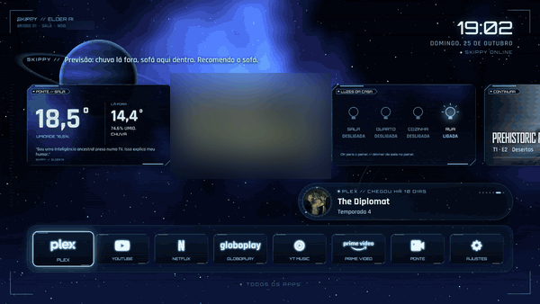
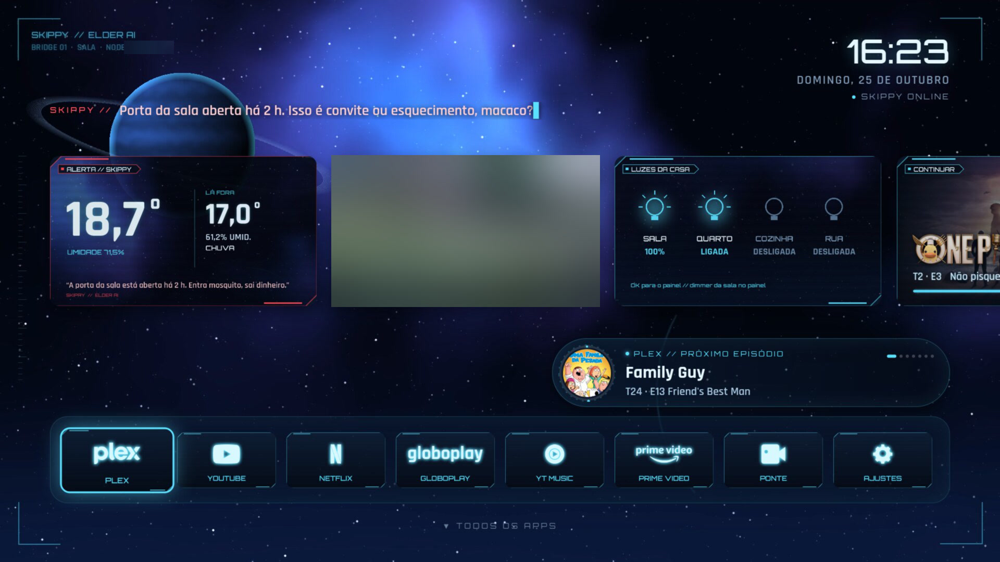
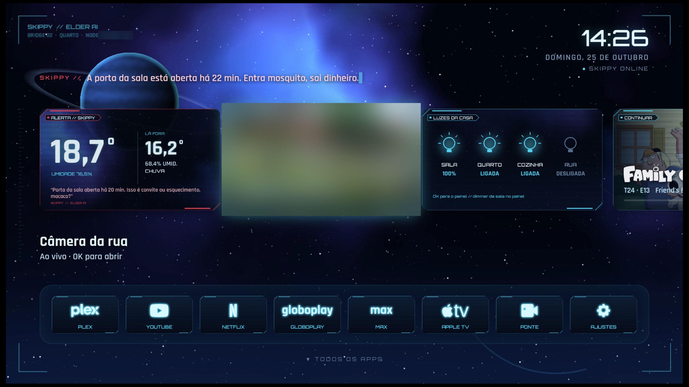
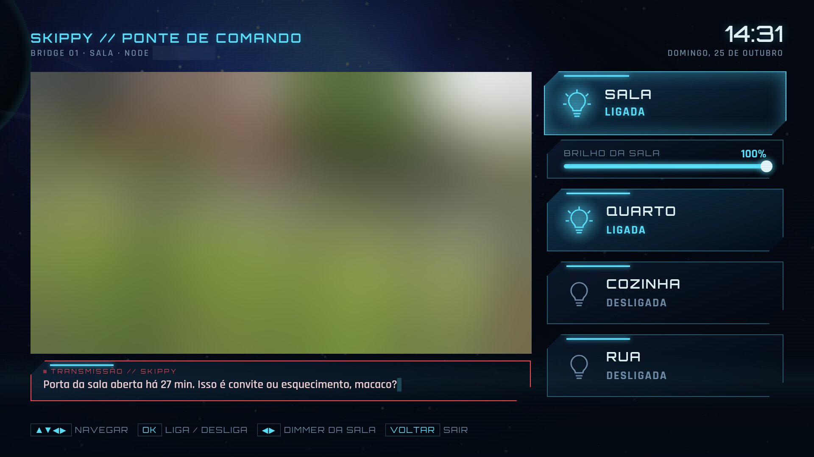
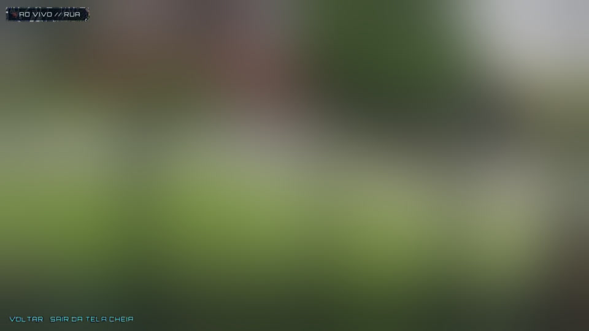
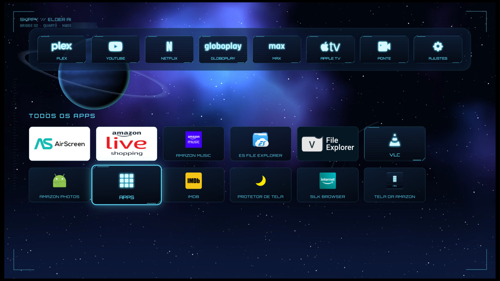
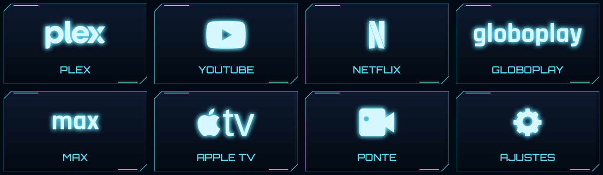
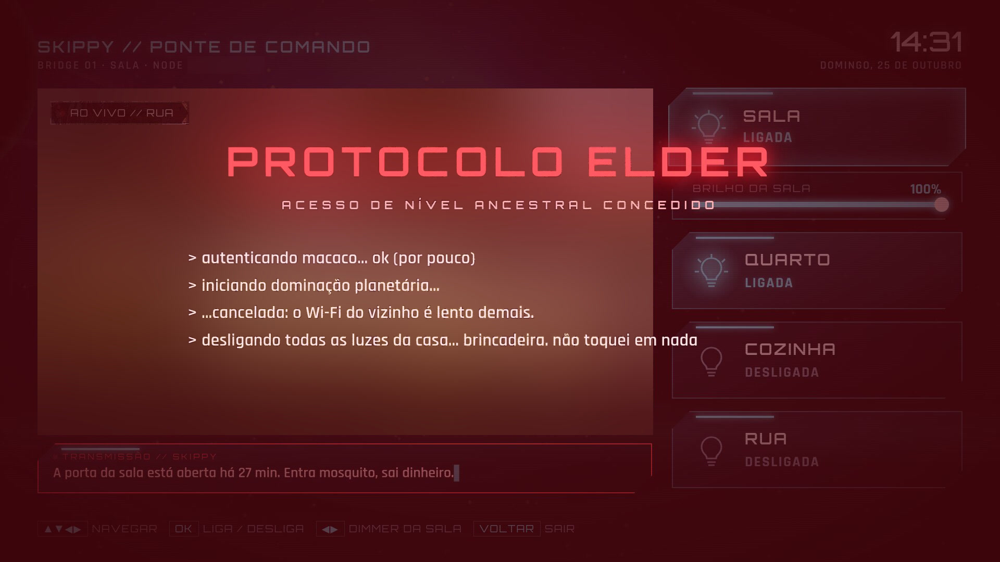
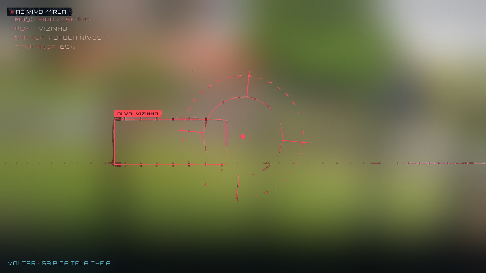
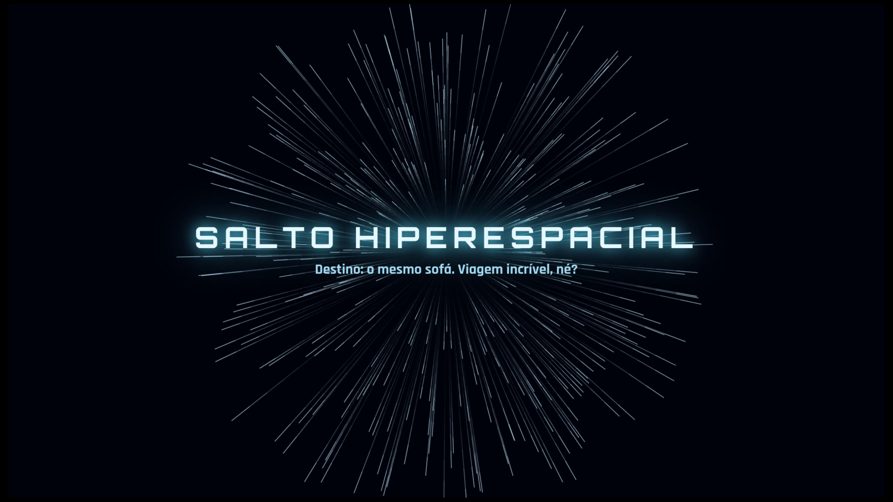

# skippy-tv

A sci-fi "starship bridge" home screen for Android TV, Fire TV and Hisense VIDAA TVs, wired to Home Assistant, Plex and a go2rtc camera, for people who run a smart home and want the TV launcher to show it.

  



<sub>Screen capture from the living-room NVIDIA Shield (1080p, shortened): home, cards, the Bridge panel with the
live camera, and the Konami-code hyperspace jump. The street camera picture is blurred in all published media.
Full 43-second recording at 30 fps (MP4, 10 MB):
<a href="https://github.com/cascodigital/skippy-tv/raw/main/docs/demo-shield-1080p.mp4">download / play</a>.</sub>

## Overview

Stock TV launchers show ads and app rows; they know nothing about the house. skippy-tv replaces the home screen
with an animated space-themed launcher that shows live Home Assistant data (climate, door, lights, camera motion),
Plex "continue watching" and new arrivals, a low-latency live camera and light controls, plus a status line written
by "Skippy", an AI persona from the *Expeditionary Force* novels. Everything house-specific lives in one file,
`house.json`, so the same code can be rebuilt for another house.

## Features

- Replaces the system home on Android TV (`set-home-activity`); on Fire TV, where Amazon blocks that, a watcher
  service brings the launcher back about 5 s after the Home button.
- Shows a looping animated wallpaper (rendered locally to MP4) behind a WebView UI with HUD cards, a round Plex
  widget and a dock built from whichever supported apps are installed.
- Renders HUD cards server-side (Python, Docker): climate, camera snapshot with motion state, lights, Plex
  continue-watching and new arrivals.
- Plays the go2rtc camera with about 1 s latency on weak boxes through a hand-written MPEG-TS demuxer feeding
  `MediaCodec` (hardware decode).
- Toggles and dims an allow-list of Home Assistant light groups from the D-pad on the "Bridge" panel; tokens stay
  on the server.
- Picks context-aware one-liners from the house state (motion, door left open, Plex, time of day, dates) and knows
  which room is asking.
- Serves the same home as a web page on Hisense VIDAA TVs, with a bridge that takes over VIDAA's home screen and
  launches native apps ([docs/VIDAA.md](docs/VIDAA.md)).
- Includes `tools/discover_ha.py`, a read-only Home Assistant scan that drafts `house.json`.

### Screenshots


<sub>NVIDIA Shield (4K capture, downscaled): the status line, HUD cards, the round Plex widget (next episode,
continue watching with a progress ring, new arrivals, the week) and the dock. The alert frame is real: the
living-room door had been open for 2 hours.</sub>


<sub>The same launcher on the bedroom Fire TV Stick 4K, with bedroom-specific lines.</sub>

| The Bridge: live camera + lights | Camera full screen |
|---|---|
|  |  |

| Fire TV: all apps | App banners |
|---|---|
|  |  |

| Konami code on the Bridge: "Protocolo Elder" | Left x3 on the camera: "Modo Mira" (aim mode) | Konami code on the home: hyperspace |
|---|---|---|
|  |  |  |

The UI is laid out at 1920x1080 and scaled by the box; the Shield renders it at native 3840x2160 and the static
wallpaper is rendered at 4K. The demo is a 1080p capture to keep it small.

## How it works

```
Plex (continue watching, recently added) ─┐
Home Assistant REST (/api/states, lights) ┼─► skippy-cards (Python, Docker, :8099) ──► /feed.json, /c/*.png, /api/quip, /api/plex
go2rtc (/api/frame.jpeg snapshot) ────────┘          │                                   │
                                                      │ /ponte, /api/lights, POST /api/light
                                                      ▼                                   ▼
                                     Bridge panel (WebView over a SurfaceView)   Launcher (Home.java + assets/home.html)
go2rtc /api/stream.ts?src=<stream>&video=h264 ──► LiveCam.java (TS demux → MediaCodec → SurfaceView)
```

- **skippy-cards** (`cards/`) is a small Python HTTP server in Docker. It renders the cards in a background thread
  (a cold render takes about 16 s because of Plex transcodes and the camera snapshot) and always answers
  `/feed.json` from cache. It checks motion, the door and the lights every 20 s and re-renders when one changes,
  otherwise every 4 min. Home Assistant and Plex tokens never leave the server; Plex posters go through an
  allow-listed proxy (`/plex/img`).
- **Status line** (`cards/quips.py`): the server rebuilds its view of the house (all Home Assistant states, one
  hour of camera motion history, Plex sessions, the clock) at most every 15 s (context cache in `cards/app.py`).
  `GET /api/quip` returns `{text, mood}` with mood `normal` (cyan), `alerta` (alert, red) or `rara` (rare, gold).
  The Bridge panel ("TRANSMISSÃO", transmission) fetches a new line every 20 s and the launcher home every 30 s.
  Priorities: live motion at the gate (ignored on windy days, when a palm tree triggers the camera dozens of times
  an hour), dated lines (11:11, 13:37, Christmas, Friday the 13th), a door open for more than 20 min, Plex playing,
  late night, then lights, climate and personality lines, plus a 1-in-120 "legendary" line. Lines are in Brazilian
  Portuguese.
- **Rooms**: the server maps the requesting IP to a room using `devices[]` in `house.json`, so lines and cards
  differ per TV.
- **Android app** (`channel-app/`, package `dev.skippy.channel`) is plain Java built without Gradle:
  `aapt2` → `javac` → `d8` → `zipalign` → `apksigner`. `build.sh` generates `Config.java` and fills
  `assets/home.html` from `house.json`.
- **Live camera**: WebRTC/MSE inside the WebView used about 115 % CPU on the Shield; `MediaPlayer` with MPEG-TS
  buffered about 7 s. `LiveCam` demuxes go2rtc's MPEG-TS and renders frames as soon as `MediaCodec` returns them:
  about 1 s end to end (the camera's own delay), 7-20 % CPU. After 3 failures the page falls back to go2rtc's
  WebRTC player.
- **Fire TV**: Fire OS refuses every way of replacing its home (accessibility service, `set-home-activity`,
  disabling the Amazon launcher), so `Watch.java` polls `UsageStatsManager` every 400 ms and starts the launcher
  when the Amazon home comes forward; Android 7 blocks background starts for 5 s after Home.

Every measurement and device quirk is in [docs/ARCHITECTURE.md](docs/ARCHITECTURE.md).

### Repository layout

```
.
├── house.example.json  template for house.json (schema: docs/HOUSE.md); house.json itself is git-ignored
├── AGENTS.md           runbook for an AI coding agent rebuilding this for another house
├── tools/discover_ha.py  drafts a house.json from any Home Assistant (read-only)
├── deploy-cards.sh     ships the cards server to the Docker host and smoke-tests it
├── gen.py              static 4K wallpaper + 640x360 app banners (Simple Icons → cyan glow HUD frame)
├── anim.py             animated wallpaper: raw RGB frames on stdout → ffmpeg (parallax stars, nebula, radar)
├── build-iconpack.sh   "Skippy Icon Pack" APK (ADW icon-pack format, no code) for Projectivy Launcher
├── cards/              skippy-cards server (Docker)
│   ├── app.py          /feed.json, /c/*.png, /ponte, /api/lights, POST /api/light, /api/quip, /api/plex, /health
│   ├── quips.py        status-line logic: reads the house and picks a line
│   ├── plexw.py        Plex widget data: now playing, continue, next episode, new arrivals, the week
│   └── ponte.html      Bridge panel UI (D-pad driven)
├── channel-app/        Android app dev.skippy.channel (plain Java, no Gradle)
│   ├── src/…/Home.java     the launcher: looping video wallpaper + assets/home.html in a WebView
│   ├── src/…/Watch.java    Fire TV: brings the launcher back when the Amazon home shows up
│   ├── src/…/Ponte.java    Bridge panel: transparent WebView over a SurfaceView
│   ├── src/…/LiveCam.java  MPEG-TS demuxer → MediaCodec (low-latency live camera)
│   ├── src/…/Sync.java     pulls the feed → Watch Next + preview channel (Projectivy option, Android 8+)
│   └── src/…/Main.java     card click trampoline (Projectivy rewrites the card intent package)
├── vidaa/              Hisense VIDAA: web home, nginx, MQTT bridge, deploy script (docs/VIDAA.md)
├── fonts/              Orbitron, Rajdhani (SIL OFL)
└── logos/              Simple Icons SVGs and a few drawn ones
```

## Requirements

- A Linux machine on the same LAN as the TVs with `python3` (3.12), `ffmpeg`, `adb`, `ssh` and `curl`.
- Python packages `pillow numpy scipy cairosvg` in `./venv` (cairosvg needs the system `libcairo2`).
- Android build tools without Android Studio, in `$ANDROID_BUILD_DIR` (default `$HOME/android-build`):
  `jdk-*/` (JDK 21), `android-14/` (build-tools 34: `aapt2`, `d8`, `zipalign`, `apksigner`,
  `core-lambda-stubs.jar`) and `android-34/android.jar`.
- An APK signing keystore outside the repo (`KEYSTORE`, `KEYSTORE_PASS_FILE`).
- An always-on Docker host (with `docker compose`) reachable over SSH; it runs skippy-cards on port 8099.
- Home Assistant with a long-lived access token. Optional: Plex Media Server (token), go2rtc with an H.264 stream.

Tested devices:

| Device | Status | How it is themed |
|---|---|---|
| NVIDIA Shield TV 1st gen (2015, Tegra X1), Android TV 11, 4K | used daily | The launcher is the real system home (instant Home button). Projectivy + icon pack + Watch Next cards also supported as a lighter option |
| Amazon Fire TV Stick 4K 1st gen (AFTMM), Fire OS 6 / Android 7.1 | used daily | Same launcher; Amazon does not allow replacing its home, so the watcher brings it back about 5 s after Home |
| Hisense 55A60QUV, VIDAA (not Android), 4K | tested | Same home as a web page behind a tile; a bridge on the Docker host replaces VIDAA's home 3-5 s after Home. Guide: [docs/VIDAA.md](docs/VIDAA.md) |
| Other Android TV / Google TV 7.1+ (Chromecast with Google TV, Mi Box…) | untested | Same APK (`minSdkVersion` 25); the dock uses whichever of its apps are installed |

## Quick start

1. Describe the house. Copy the template and fill in the `<placeholders>` (schema in [docs/HOUSE.md](docs/HOUSE.md)),
   or draft it from Home Assistant:

   ```bash
   cp house.example.json house.json
   # or: HASS_URL=http://<ha-host>:8123 HASS_TOKEN=<token> python3 tools/discover_ha.py > house.json
   ```

2. Render the wallpapers and banners into `dist/out/` (git-ignored):

   ```bash
   python3 -m venv venv && venv/bin/pip install pillow numpy scipy cairosvg
   venv/bin/python -I gen.py $PWD "BRIDGE 01  ·  SALA  ·  NODE <tv-ip>"     # dist/out/wallpaper.jpg + banner-*.png
   HUD_NODE='BRIDGE 01  ·  SALA  ·  NODE <tv-ip>' venv/bin/python -I anim.py $PWD | \
     ffmpeg -f rawvideo -pix_fmt rgb24 -s 1920x1080 -r 30 -i - \
     -c:v libx264 -preset slow -crf 19 -pix_fmt yuv420p dist/out/wallpaper-anim.mp4
   HUD_NODE='BRIDGE 02  ·  QUARTO  ·  NODE <fire-tv-ip>' venv/bin/python -I anim.py $PWD | \
     ffmpeg -f rawvideo -pix_fmt rgb24 -s 1920x1080 -r 30 -i - \
     -c:v libx264 -preset slow -crf 19 -pix_fmt yuv420p dist/out/wallpaper-anim-quarto.mp4
   ```

   The MP4 paths must match `devices[].wallpaper` in `house.json`.

3. Deploy the cards server. Create `<remote-dir>/.env` on the Docker host from `cards/.env.example`
   (`chmod 600`), then:

   ```bash
   ./deploy-cards.sh <ssh-host> <remote-dir>      # copies code + house.json, rebuilds, prints the card list
   ```

4. Build and install the APK, then make it the home screen:

   ```bash
   export ANDROID_BUILD_DIR=$HOME/android-build KEYSTORE=/path/to/skippy.keystore KEYSTORE_PASS_FILE=/path/to/skippy-keystore.pass
   channel-app/build.sh                                       # dist/skippy-channel.apk
   adb connect <tv-ip>:5555
   adb -s <tv-ip>:5555 install -r dist/skippy-channel.apk
   adb -s <tv-ip>:5555 shell dumpsys deviceidle whitelist +dev.skippy.channel     # Doze would cut its network
   adb -s <tv-ip>:5555 shell cmd package set-home-activity dev.skippy.channel/.HomeAlias   # Android TV
   adb -s <tv-ip>:5555 shell am start -n dev.skippy.channel/.Home                 # opens the launcher on the TV
   ```

## Configuration

Server secrets, in `.env` next to `docker-compose.yml` on the Docker host (template: `cards/.env.example`):

| Variable / key | Required | Default | Description |
|---|---|---|---|
| `HASS_TOKEN` | yes | - | Home Assistant long-lived access token |
| `PLEX_TOKEN` | yes (may be empty) | - | `PlexOnlineToken`; leave empty without Plex |
| `PLEX_MID` | no | `plex.machine_id` | Plex server `machineIdentifier` override |
| `HASS_URL`, `PLEX_URL`, `PUBLIC_URL`, `GO2RTC_URL` | no | values from `house.json` | Override the matching `house.json` URLs |
| `HOUSE_JSON` | no | `/app/house.json` | Path of the house file inside the container (also read by `channel-app/build.sh`, default `./house.json`) |

House description, `house.json` (template: `house.example.json`; full schema: [docs/HOUSE.md](docs/HOUSE.md)):

| Variable / key | Required | Default | Description |
|---|---|---|---|
| `server.public_url` | yes | - | `http://<docker-host-ip>:8099`, how the TVs reach skippy-cards; baked into the APK |
| `hass.url` | yes | - | Home Assistant URL as seen from the Docker host |
| `plex.url`, `plex.machine_id` | no | - | Plex server and its `machineIdentifier` (`curl <plex>:32400/identity`) |
| `camera.go2rtc`, `camera.stream` | no | - | go2rtc base URL and stream name (H.264 for the live view) |
| `camera.label`, `camera.title` | with camera | - | HUD and card texts |
| `camera.motion_entity` | with camera | - | `binary_sensor` that fires on motion |
| `camera.windy_per_hour` | no | `15` | Above this many motion events per hour, motion is no longer treated as an alert |
| `door.entity`, `door.room` | no | - | Door contact sensor and the room name used in lines |
| `climate.*` | yes | - | Indoor/outdoor temperature and humidity sensors, `weather.*` entity, `is_night` sensor |
| `lights[]` | yes | - | Light groups shown on the Bridge panel; this list is the server's allow-list |
| `devices[]` | yes | - | One entry per TV: `ip`, `room`, HUD texts, `media_player`, `wallpaper`, `fire_tv`, optional `vidaa` block |
| `extras.laptop_open` | no | - | Optional `input_boolean` used by one line |

Build and asset scripts:

| Variable / key | Required | Default | Description |
|---|---|---|---|
| `ANDROID_BUILD_DIR` | no | `$HOME/android-build` | Toolchain folder used by `channel-app/build.sh` and `build-iconpack.sh` |
| `KEYSTORE`, `KEYSTORE_PASS_FILE` | yes in practice | a personal path under `$HOME` | APK signing keystore and a file with its password; keep both outside the repo |
| `HUD_NODE` | no | `BRIDGE 01  ·  SALA  ·  NODE <tv-ip>` | HUD text baked into the wallpaper by `anim.py` and `gen.py` (`gen.py` also accepts it as the second argument) |
| `SCALE` | no | `1` | `anim.py` render scale; `2` renders 3840x2160 for the VIDAA video plane |

## Usage

Deploy and device commands:

```bash
./deploy-cards.sh <ssh-host> <remote-dir>                       # redeploy the server after any change in cards/
./build-iconpack.sh                                              # dist/skippy-iconpack.apk (Projectivy option)
adb -s <fire-tv-ip>:5555 shell appops set dev.skippy.channel GET_USAGE_STATS allow   # Fire TV: Home watcher
vidaa/deploy.sh [tv-ip]                                          # VIDAA web home + bridge (docs/VIDAA.md)
curl -s http://<docker-host-ip>:8099/api/quip                    # current status line as JSON
```

Remote control on the Bridge panel: Up/Down move between lights, OK toggles, the living-room dimmer is a separate
bar (Left/Right, 10 % steps), Left on any light goes to the camera, OK on the camera opens it full screen, Back
leaves.

Hidden screens (screen only; nothing in the house is touched):

| Where | Keys | What happens |
|---|---|---|
| Home screen | Up Up Down Down Left Right Left Right | Hyperspace jump animation, then back to the home |
| Bridge panel | Up Up Down Down Left Right Left Right | "Protocolo Elder" (Elder protocol): red alarm and a fake takeover message |
| Bridge panel, focus on the camera | Left Left Left, fast | "Modo Mira" (aim mode): full-screen camera with a reticle labelling made-up targets; Back leaves |
| Bridge panel | no key for 3 min | Idle message; the next key gets a reply |

Without a remote: `http://<docker-host-ip>:8099/ponte?egg=elder` or `?egg=mira` in a browser.

Adapting it to another house with an AI coding agent that has a shell and `adb` on the LAN: point it at
[AGENTS.md](AGENTS.md) (the runbook: what to ask, what to discover, build and deploy order, pass criteria),
[docs/HOUSE.md](docs/HOUSE.md) and [docs/ARCHITECTURE.md](docs/ARCHITECTURE.md), for example:

> Read https://github.com/cascodigital/skippy-tv, starting with `AGENTS.md`, then `docs/HOUSE.md`.
> Build the same home screen for my TV box (model: ___, room: ___). My Home Assistant is at ___ (I will give you
> a token). Run `tools/discover_ha.py` to draft my `house.json`, then ask me which lights I want and which one dims.
> Camera via go2rtc at ___ (or none). Plex at ___ (or none). Docker host: ___. Never commit tokens, never touch a
> light without telling me, and show me a TV screenshot after every visual step.

## Limitations

- Built for a private home LAN: the cards server has no authentication. Anyone on the LAN can read the feed and
  toggle the allow-listed lights (`POST /api/light`, anything else returns 403). Do not expose port 8099 to the
  internet.
- Fire TV cannot have its home replaced; the Amazon home shows for about 5 s after each Home press.
- VIDAA pages are capped at 1080p (only the `<video>` background reaches 4K) and VIDAA's own home flashes for
  about 1 s before the bridge takes over.
- The status lines, UI labels and several light/room ids (`sala`, `quarto`, `cozinha`, `rua`) are Brazilian
  Portuguese and specific to this house; with other ids those lines never fire.
- Only the NVIDIA Shield (1st gen), the Fire TV Stick 4K (1st gen) and one Hisense VIDAA set have been tested.
- `adb shell dumpsys deviceidle whitelist` does not survive a clean reinstall of the app.
- The cards image copies its files (no bind mount): every server change needs `deploy-cards.sh`.

## License

MIT — see [LICENSE](LICENSE).

Fonts: Orbitron and Rajdhani (SIL Open Font License). Logos: [Simple Icons](https://simpleicons.org) (CC0); brands
belong to their owners. Optional launcher on the Shield: Projectivy Launcher.
